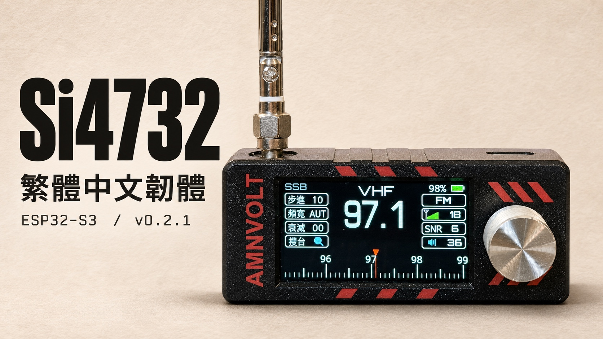
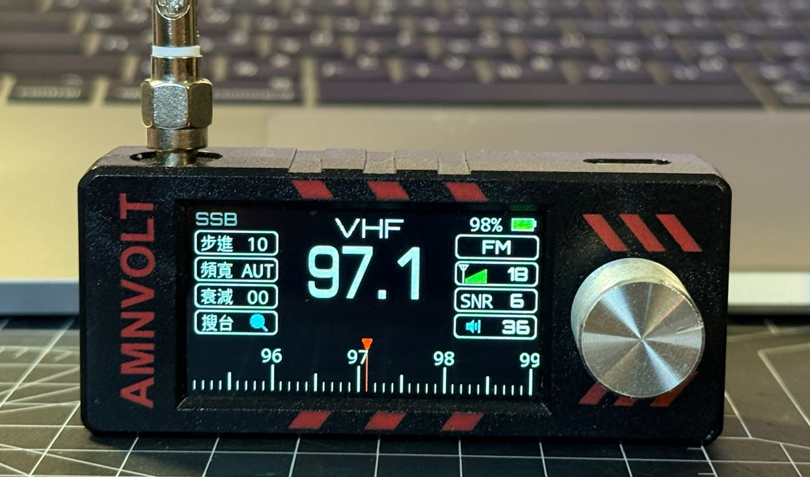
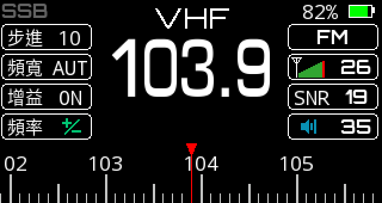
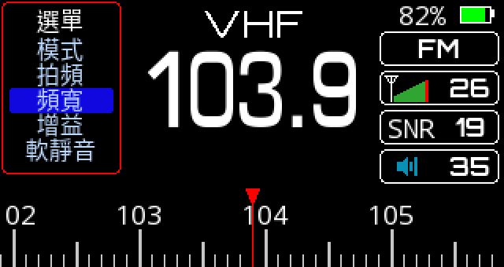

# Si4732 收音機繁體中文韌體



為 ESP32-S3 與 Si4732-A10 多波段收音機製作的繁體中文介面。0.2.1 提供 14 項旋鈕選單、可調背光及電台記憶，並修正舊設定損壞時反覆重新開機的問題。

**[下載 v0.2.1 韌體與 SHA-256 校驗檔](https://github.com/MAXXTANG/si4732-zh-tw/releases/tag/v0.2.1)**

## 實機照片



實拍時收音機調在 **FM 97.1 MHz**。螢幕左側可見步進、頻寬、衰減與搜台，底部指針標出目前頻率。頁首封面依實機照片以 AI 輔助製作。

## 介面與操作

轉動旋鈕可調整頻率。快速連按兩下開啟選單，轉動選取項目，再按一下進入。以下兩張示意圖使用韌體內的字型與圖示，以 FM 103.9 MHz 為例呈現 320 × 170 的螢幕版面。

| FM 調諧主畫面 | 旋鈕選單 |
| --- | --- |
|  |  |

選單可調整音量、步進、模式、拍頻、頻寬、增益、軟靜音與波段，也可儲存或讀取電台。「自動熄屏」可選常亮或 1 至 99 秒。背光熄滅後，轉動或按下旋鈕即可喚醒。

## 已驗證的硬體

| 部位 | 實機與韌體設定 |
| --- | --- |
| 控制器 | ESP32-S3-WROOM-1，實讀 ESP32-S3 rev 0.2、16 MB Flash、8 MB PSRAM |
| 收音與音訊 | Si4732-A10、NS4160，實機收音晶片 I²C 位址為 `0x63` |
| 螢幕 | 使用 TFT_eSPI 的 ST7789、8 位元並列模式，橫向 320 × 170。此設定已在實機顯示彩條與文字，面板控制晶片的料號仍待辨識。 |
| 接線 | I²C SDA 18、SCL 17、Si4732 重設 16、旋鈕 A/B 2/1、按壓 21、背光 38、擴大器使能 10、靜音 3 |
| Flash 配置 | `app3M_fat9M_16MB`，單一應用程式槽 3 MB。映像標頭為 DIO、80 MHz。 |

### 實機驗證範圍

- 0.2.1 修正舊設定後，已在這台收音機確認畫面穩定、繁中選單可捲動，喇叭可聽見 FM 廣播。
- 更新署名後，已再次用旋鈕進入「關於」，逐行確認「繁體中文漢化與改進：＠maxxtang(Github)」與「繁體中文漢化：0.2.1」，並確認舊 QQ 群資訊已移除。[實機驗證紀錄](validation/artifact-validation.json)
- 發佈映像以相同韌體原始碼重新編譯，將 SDK 診斷字串中的本機路徑換成固定路徑。三段可執行程式碼共 322,512 bytes 與實機版本逐位元相同。應用映像的差異限於路徑、編譯日期／時間及相應校驗值。公開映像已離線驗證，實機驗證對象為更新署名時刷入的版本。[公開版本比對紀錄](validation/public-release.json)
- AM／SSB、在實機儲存與讀取電台、設定熄屏後喚醒及重新開機保留設定，仍待逐項實測。

## 韌體下載與寫入範圍

在發行頁下載 `si4732-zh-tw-0.2.1-firmware.zip` 和同名的 `.sha256`。macOS 可在下載目錄執行下列指令，分別核對 ZIP 與解壓後的五個映像。[v0.2.1 發行頁](https://github.com/MAXXTANG/si4732-zh-tw/releases/tag/v0.2.1)

```sh
shasum -a 256 -c si4732-zh-tw-0.2.1-firmware.zip.sha256
unzip si4732-zh-tw-0.2.1-firmware.zip -d si4732-v0.2.1
cd si4732-v0.2.1
shasum -a 256 -c SHA256SUMS
```

| 映像 | 用途 |
| --- | --- |
| `Si4732Traditional.ino.bin` | 應用程式。本次實機使用已核對的 app0 分割區，位址為 `0x10000`。其他收音機須先核對板型、分割表與開機槽位。 |
| `Si4732Traditional.ino.merged.bin` | 從 `0x0` 起寫入的 16 MB 建置映像。寫入會覆蓋整顆 Flash，包含原有設定與電台記憶。 |
| Bootloader、分割表、`boot_app0.bin` | 封裝內的 `flash_args` 列出各段位址。 |

保留還原能力需要先讀出自己收音機的完整 Flash，核對容量及校驗碼，並將原機檔案另存。這台測試機的原廠映像、個別裝置設定與 USB 刷寫紀錄由持有人在本機保存。

## 從原始碼編譯

需要 Arduino CLI、Python 3 和 Bash。本版使用 Arduino CLI 1.5.1 與 Espressif Arduino Core 3.3.12，顯示及收音函式庫隨專案提供。首次設定會下載固定版本的 SDK。已安裝 SDK 時，可用環境變數 `ARDUINO_CORE_DATA` 指向現有的 Arduino data 目錄。

```sh
git clone https://github.com/MAXXTANG/si4732-zh-tw.git
cd si4732-zh-tw
bash tools/setup.sh
bash build.sh
python3 tools/package_firmware.py
```

`dist/` 會包含應用程式、合併映像、發佈 ZIP 及其校驗檔。原始碼已附上字型標頭，直接編譯即可使用繁中介面。若修改選單或署名文字，先編輯 sketch，再安裝 Pillow、準備 Noto Sans Mono CJK TC Regular 並重建字型及示意圖。

```sh
python3 tools/make_font.py --font /path/to/NotoSansMonoCJKtc-Regular.otf
python3 tools/make_ui_preview.py
bash build.sh
```

## 專案內容

| 目錄 | 內容 |
| --- | --- |
| [firmware/Si4732Traditional](firmware/Si4732Traditional) | Arduino sketch、調諧與旋鈕邏輯、圖示及編譯好的中文字型 |
| [vendor](vendor) | 固定版本的 TFT_eSPI 與 PU2CLR SI4735 |
| [assets](assets) | 專案封面、實機照片、兩張介面示意圖、VLW 字型及字形覆蓋檢查 |
| [diagnostics/Si4732DisplayTest](diagnostics/Si4732DisplayTest) | 獨立顯示測試 sketch，開啟背光並繪製彩條與文字 |
| [tools](tools) | 建置、字型、翻譯、示意圖與發佈封裝工具 |
| [validation](validation) | 分割表、實機驗證摘要、發行映像比對及可用模擬設定重跑的 C++ 回歸測試 |

若要從上游重新產生繁中 sketch，將上游 clone 至 `upstream/`，切換到 `validation/upstream-commit.txt` 指定的提交，再執行 `python3 tools/localize.py`。翻譯工具會重寫 sketch，並套用 `tools/display-power.patch`。

## 來源與使用條款

原始硬體由 Sunnygold 設計，中文軟體與改進署名 zooc，繁體中文漢化與改進由 **@maxxtang** 整理。上游指定基礎韌體僅供學習交流並禁止商用。各函式庫與字型保留各自的授權。[基礎韌體](https://github.com/zhang-chong/4732mini/tree/5334e7bc5e44a7b66bbbbd5183164147ec5f8641) · [第三方署名與授權](THIRD_PARTY_NOTICES.md)
